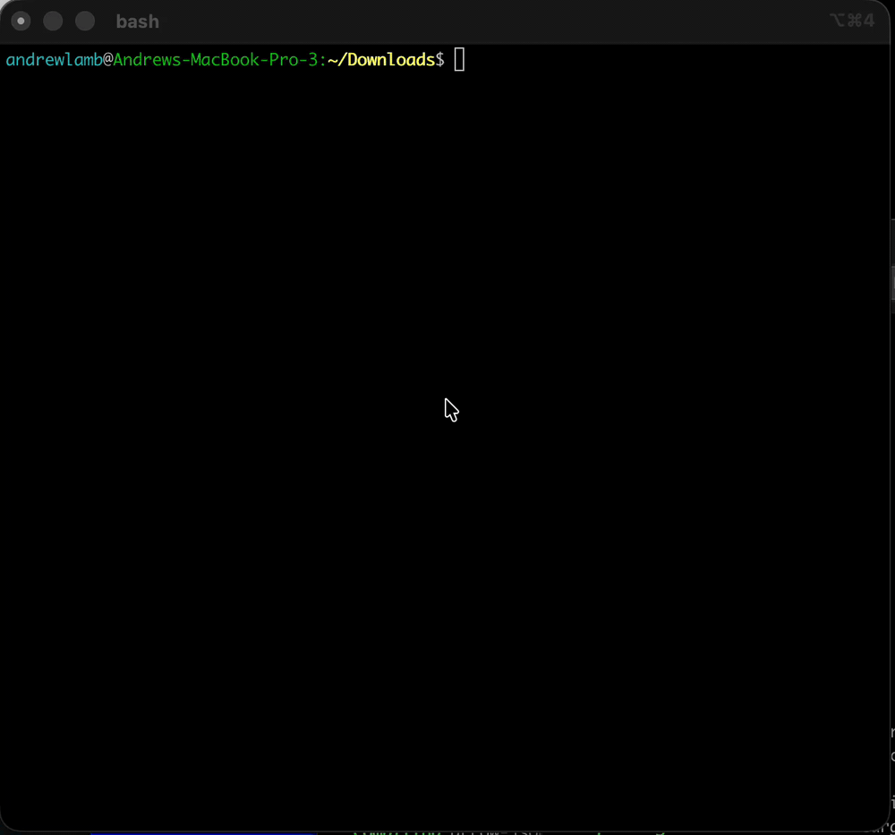
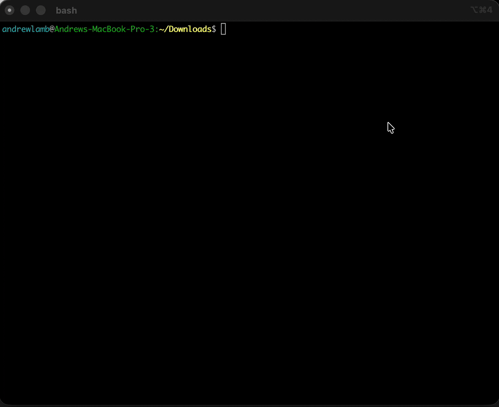

# tpcgen-cli

`tpcgen-cli` is a high-performance, parallel command line interface for
generating [TPC-H] and [TPC-DS] data.

It generates data in multiple formats including [Apache Parquet], CSV, and
pipe-delimited (`tbl` for TPC-H, `dat` for TPC-DS).

This tool is more than 10x faster than the next fastest TPC-DS generator we know
of (`duckdb`), 4x-27x faster than the official C `dsdgen`, and 12x-69x faster
than the Java port used by Trino. On an 8 core AWS instance it generates data at
over 1 GB/s, faster than a single EBS volume can write. See [BENCHMARKS.md] for
more details on performance and benchmarking.

## Try with `uvx`

```shell
uvx tpcgen-cli tpch parquet -s 1 --output-dir /tmp/tpch
```





## Install with `pip`

```shell
python -m pip install tpcgen-cli
```

## Examples

```shell
# TPC-H Scale Factor 1, all tables, in `tbl` (pipe-delimited) format in the `/tmp/tpch` directory
# Note: `tpcgen-cli tpch tbl` also works explicitly
tpcgen-cli tpch -s 1 --output-dir /tmp/tpch

# TPC-H Scale Factor 1, all tables, in CSV format
tpcgen-cli tpch csv -s 1 --output-dir /tmp/tpch

# TPC-DS Scale Factor 10, all tables, in Apache Parquet format,
# 10 part(itions) written to `/tmp/tpcds/<table_name>/<table_name>.<part>.parquet`
tpcgen-cli tpcds parquet -s 10 --parts 10 --output-dir /tmp/tpcds

# TPC-DS Scale Factor 100, store_sales table, in Apache Parquet format,
# 10 part(itions) written to `/tmp/tpcds/store_sales/store_sales.<part>.parquet`
tpcgen-cli tpcds parquet -s 100 --tables store_sales --parts 10 --output-dir /tmp/tpcds

# TPC-H Scale Factor 1, Per-column encodings 
# (overrides Parquet writer defaults for named columns)
tpcgen-cli tpch parquet -s 1 --tables lineitem --column-encoding=l_comment=DELTA_LENGTH_BYTE_ARRAY --output-dir /tmp/tpch

# TPC-DS Scale Factor 1, all tables, in CSV format in the `/tmp/tpcds` directory
# Note: `tpcgen-cli tpcds` with no format writes `dat` (pipe-delimited) files
tpcgen-cli tpcds csv -s 1 --output-dir /tmp/tpcds

# TPC-H `tbl` and TPC-DS `dat` rows end with a `|` after the last field.
# `--no-trailing-delimiter` omits it (output matches `dbgen` built with
# -DEOL_HANDLING and `dsdgen -terminate N`). A TPC-DS row whose last field is
# NULL keeps the delimiter before it: `a||` becomes `a|`.
tpcgen-cli tpch tbl -s 1 --no-trailing-delimiter --output-dir /tmp/tpch
tpcgen-cli tpcds dat -s 1 --no-trailing-delimiter --output-dir /tmp/tpcds
```

## Performance


Times to create TPC-DS tables in Parquet format using `tpcgen-cli` and `duckdb`
for various scale factors on an 8 core AWS `c8gn.2xlarge`. See [BENCHMARKS.md]
for details.

| Scale Factor | `tpcgen-cli`  | DuckDB       | DuckDB (proprietary) |
| ------------ | ------------- | ------------ | -------------------- |
| 1            | `0:01.77`     | `0:18.04`    | `0:17.27`            |
| 10           | `0:12.00`     | `2:33.04`    | `2:26.48`            |
| 100          | `1:42.13`     | N/A (OOM)    | `19:42.43`           |
| 300          | `4:57.89`     | N/A (OOM)    | `56:19.89`           |

- DuckDB (proprietary) is the time required to create TPC-DS data in the
  proprietary DuckDB format (`CALL dsdgen()`). DuckDB is that time plus
  `EXPORT DATABASE (FORMAT parquet)`.
- At Scale Factors 100 and 300 the DuckDB export to Parquet failed on this
  16 GB machine, so only the proprietary format time is reported.

[TPC-H]: https://www.tpc.org/tpch/
[TPC-DS]: https://www.tpc.org/tpcds/
[Apache Parquet]: https://parquet.apache.org/
[BENCHMARKS.md]: https://github.com/datafusion-contrib/tpcgen-rs/blob/main/tpcgen-cli/benchmarks/BENCHMARKS.md
